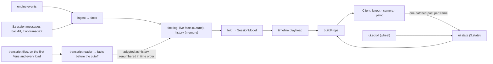

# Architecture

Why agent-lens is shaped the way it is, and where each concern lives. The
[README](../README.md) covers installing and using the mod; the source files
open with a comment that states what each one does.

## Two modules, one owner of truth

The mod runs as two modules with different lifetimes:

- **The hooks module** ([`hooks/register.tsx`](../hooks/register.tsx) and
  the rest of [`hooks/`](../hooks)) survives the pane closing and reopening.
  It owns everything that must outlive a single drawing: the fact log, the
  session model folded from that log, the replay timeline, and the interface
  state.
- **The Client** ([`hooks/client/`](../hooks/client)) is a surface module
  that the engine mounts, faults and remounts at will. It owns only
  presentation: layout, camera, animation, hit-testing, decoding input and
  painting. It re-seeds itself from props on every mount, so a remount does
  not lose state and does not replay every chip's flash.

These rules hold the design together. Break one and a known failure returns:

1. **Live facts live in `$.state`; history comes from the transcript.**
   Module memory dies on a hot reload or a worker respawn, so
   [`hooks/persist.ts`](../hooks/persist.ts) mirrors the facts seen live
   to `$.state` in chunks. `$.state` itself is lost when Claude Code
   restarts. History is imported from the session's transcript files
   ([`hooks/transcript.ts`](../hooks/transcript.ts),
   [`hooks/transcript-io.ts`](../hooks/transcript-io.ts)) and kept in
   module memory only, with no cap on its size. The first `/lens` for a
   log reads every record dated before the log began recording live
   (`liveSince` in the log meta). From then on every load of the log
   reads the transcript again, and the boundary moves to the load time:
   the transcript supplies everything before it, including what happened
   while the module was down, and the live facts persisted before it are
   dropped. A reload therefore shows what a restart would, and nothing is
   counted twice, since live and imported facts for the same model call
   carry different dedupe keys and only the one time boundary keeps them
   apart. A request still being written at the cutoff, with no record yet
   saying why the model stopped, is left to the live hooks. Each import renumbers the log in time order, history first,
   because the fold and the layout read seq as arrival order; the Client
   then treats everything shown as seen, and the layout follows from the
   new order. When the transcript cannot be found or read, backfill from
   `$.session.messages` runs instead, with prompts on the first `/lens`
   and without them on a reload. It has no times or token counts, keeps
   only the newest 4096 rows and has no workflow agents, so it is only a
   fallback.
2. **Interface state lives in the hooks module.** The selection, the open
   overlay, the camera mode, the dragged card positions and the timeline
   track's zoom window sit in `$.state`
   ([`hooks/uistate.ts`](../hooks/uistate.ts)), so a remount or a reload
   restores them. The zoom window indexes facts, so it is cleared when an
   import renumbers the log.
3. **There is one props builder.** `ui.render` and `ui.message` both answer
   with [`buildProps`](../hooks/props.ts). An answer to `ui.message` lasts
   only until the next redraw, so a second builder would drop the details
   or the selection on the next frame.
4. **The Client posts once per frame.** The surface keeps only the last post
   in a frame, so [`hooks/client/outbox.ts`](../hooks/client/outbox.ts)
   batches intents. Posts are input from code, so
   [`hooks/intents.ts`](../hooks/intents.ts) validates every intent before
   applying it.
5. **Observer hooks never interfere with the session.** Hooks on tool calls,
   spawns, turns and prompts call `next(e)` once and return its result
   unchanged. Ingest runs inside `try/catch` and awaits nothing slow on the
   chain.
6. **Data is minimal and sanitised.** Facts hold ids, tool names, outcomes,
   token counts and times. A prompt keeps only its first line. Tool inputs,
   tool outputs and answers are never stored. Every drawn string passes
   through `cellText` in [`hooks/text.ts`](../hooks/text.ts), so terminal
   control sequences from the session cannot reach the screen.

## Data flow

The Client never receives wheel events. A `ui.scroll` hook in the hooks
module records each tick in the interface state with a sequence number, and
the Client applies each tick once.

## Where things live

| Concern | Owner |
| --- | --- |
| Registration, lifecycle, `/lens`, pane placement, fault handling | [`hooks/register.tsx`](../hooks/register.tsx), [`hooks/fault-gate.ts`](../hooks/fault-gate.ts) |
| Engine events to facts | [`hooks/ingest.ts`](../hooks/ingest.ts), vocabulary in [`hooks/model/facts.ts`](../hooks/model/facts.ts) |
| Transcript files to facts | [`hooks/transcript.ts`](../hooks/transcript.ts) (pure), [`hooks/transcript-io.ts`](../hooks/transcript-io.ts) (finding and reading the files) |
| Facts to model | [`hooks/model/fold.ts`](../hooks/model/fold.ts), [`hooks/model/runs.ts`](../hooks/model/runs.ts) |
| Replay pacing and seeking | [`hooks/model/timeline.ts`](../hooks/model/timeline.ts) |
| Shared frame interval | [`hooks/frame.ts`](../hooks/frame.ts) |
| Drawing | [`hooks/client/graph.tsx`](../hooks/client/graph.tsx) is the entry; each other file in that folder owns one part of the picture |
| Engine API types | Generated into `.claude-plugin/types/` when the engine loads the mod (git-ignored); [`types/index.d.ts`](../types/index.d.ts) holds the state contract the two modules share |
| Tests and synthetic fixtures | [`tests/`](../tests), [`tests/fixtures/generate.ts`](../tests/fixtures/generate.ts) (events), [`tests/fixtures/transcript.ts`](../tests/fixtures/transcript.ts) (transcript files) |

## Platform limits the design respects

These come from measurements against the mod API, not from taste. Change
them only after measuring again.

- **No WebAssembly, `eval`, npm imports or `import()` in a module.** That is
  why the project is plain TypeScript with no runtime dependencies.
- **A Client tree must serialize to under 100,000 characters.** Past it the
  Client crashes; per-cell colour over roughly 2,800 cells was enough. The
  painter merges cells into same-colour runs and paints again with coarser
  colours when over its budget (`PAINT_BUDGET` in
  [`paint.tsx`](../hooks/client/paint.tsx)). Props are capped the same way
  by measured size, not by item counts (`BUDGET` in
  [`props.ts`](../hooks/props.ts)).
- **The surface clock quantises the frame rate.** The reasons for the
  chosen interval are in [`hooks/frame.ts`](../hooks/frame.ts). Animation
  steps by elapsed time, so a slow frame never slows the motion.
- **Keys reach the Client only after a click inside it, and Escape always
  returns focus to the prompt.** That is why closing is `x`. `$.ui.focus` is
  refused and is not needed.
- **The dock takes at most 45% of the terminal's width**, so there is no
  fullscreen view. The inline fallback draws a compact layout.
- **`session.start` does not fire for `/clear`.** The mod resets on
  `session.end` with reason `clear` or `resume`.
- **`$.state` survives hot reloads, not a restart, and holds 4 MiB for
  the whole mod.** Only live facts are kept there; history comes from the
  transcript on every load. A fold of 63,500 facts per seek measured
  under 8 ms, so the whole history fits in memory. A log kept before
  history moved to memory has its imported part loaded as history, and
  the chunks it filled are emptied on the next flush, since `$.state`
  has no delete.
- **`$.fs.read` refuses files over 4 MiB, and `$.process.run` cuts stdout
  at 4 MiB.** Larger transcripts (35.6 MB seen) are streamed through
  `$.process.spawn(['cat', path])`; with no `cat`, as on Windows, the
  import falls back to backfill.
- **`turn.step` is a streaming event.** Its hook must be an
  `async function*` that passes every chunk through; the engine refuses a
  plain function. Each step reports one model call's usage, and
  `turn.complete` reports the sum of the turn's steps, so only steps are
  counted. A compaction's summarizer fires no `turn.step`, so its usage is
  not counted.
- **Another plugin can answer `session.compact` and classic hooks without
  passing them on.** The mod relies on neither: it finds the transcript by
  session id under the configuration directory instead of reading
  `transcript_path`.
- **`$.agent.list()` drops agents that have ended and never lists workflow
  agents.** Workflow agents are grouped by `workflow.runId`, and their status
  comes from `turn.complete`.
- **Plugin names starting with `claude-` are reserved.** The mod's name avoids that prefix.

## Decisions and rejected alternatives

| Chosen | Rejected | Why |
| --- | --- | --- |
| A TypeScript mod | Embedding an existing Rust terminal UI | Modules cannot run WebAssembly, and `$.process.spawn` has no interactive stdin. |
| A fact log folded in place, with a full refold on every seek | Copying the model per fact, or keeping a ladder of snapshots | The copying fold was quadratic. A refold is cheap enough that the snapshot ladder was never needed; the timeline tests benchmark seeking. |
| A fold that depends only on the set of facts | A fold that depends on arrival order | Backfill and live events arrive interleaved and duplicated. Keyed stores plus seq-wins make the order irrelevant, and a shuffle test checks it. |
| Cards laid out by a pure function of the agents shown and the dragged positions, recomputed when either changes, frozen during a drag, and eased into place | Placing cards in arrival order, each fixed once placed | Positions that depended on history made replay differ from live, and made a subtree growing under an earlier row slide sideways, away from its parent. A dragged card keeps its slot, so a drag moves nothing else. |
| Siblings in waves: those that ran at the same time share a row of at most four, and a later wave starts a row below the parent's subtree, its edges along a spine | One row per parent, however many children; a wrap that follows the pane width | One long row made long sessions wide. Rows from the fold's wave index (the `wave` field) and a fixed width depend only on arrival order, so they do not depend on the pane, and a resize moves nothing; a wrap by pane width would move cards on every resize. The fold computes the wave because sending each agent's spawn and end seqs costs about 14,000 characters of props at 400 agents. |
| Live engine events, plus a transcript import when `/lens` opens and on every later load, kept in memory | Tailing transcript files on disk; backfill from message history alone; persisting the import to `$.state` under a fact cap | The engine delivers events with agent ids, so live data needs no tailing. Message history loses everything a compaction replaced and has no times, tokens or workflow agents; the transcript keeps them, and a 35.6 MB one streams and parses in about 0.4 s. A capped import in `$.state` dropped the oldest tokens, calls and prompts of long sessions, and a reload left a gap the transcript can fill. |
| A zoomable timeline track: a window over all the history, panned to hold the playhead, plus step and marker keys | Paging history in and out, or a fixed track over the whole session | With all history loaded, one column of a long session's track covered hundreds of facts, so a click could not land on one. The window is only a view, so replay, seeks and going live pan it without writing state. |
| One usage fact per model call, from `turn.step` | A turn's summed usage from `turn.complete` | ctx must be the latest call's context, not a turn's sum, and tok must count every call once. |
| Synthetic test fixtures | Fixtures captured from real sessions | Real sessions carry personal paths and prompt text. |

## Non-goals

- Visualising any session other than the live one, or any provider other
  than Claude Code.
- A fullscreen, band or pop-out view.
- Showing reasoning text. The engine returns thinking blocks empty.
- Publishing to the plugin directory.

## Verifying a change

`pnpm check` runs the typecheck, the plugin tests and plugin validation (see
[`package.json`](../package.json)). Tests cannot show frame rate, hover or
real-terminal drawing, so check those by hand: run
`claude --plugin-dir "$PWD"` in a terminal at least 110 columns wide,
spawn subagents and a workflow, then scrub, `/clear` and reload while the
session is running. To reproduce a layout offline, print the grid from a
scratch test, because screen captures from terminal multiplexers garble wide glyphs.
