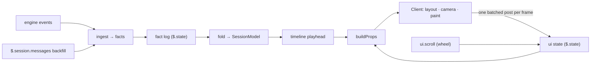

# Architecture

Why session-viz is shaped the way it is, and where each concern lives. The
[README](../README.md) covers installing and using the mod; the source files
open with a comment that states what each one does.

## Two modules, one owner of truth

The mod runs as two modules with different lifetimes:

- **The hooks module** ([`hooks/register.tsx`](../hooks/register.tsx) and
  the rest of [`hooks/`](../hooks)) survives the pane closing and reopening.
  It owns everything that must outlive a single drawing: the fact log, the
  session model folded from that log, the replay timeline, and the interface
  state.
- **The Client** ([`hooks/client/`](../hooks/client)) is a surface module
  that the engine mounts, faults and remounts at will. It owns only
  presentation: layout, camera, animation, hit-testing, decoding input and
  painting. It re-seeds itself from props on every mount, so a remount does
  not lose state and does not replay every chip's flash.

These rules hold the design together. Break one and a known failure returns:

1. **The log lives in `$.state`, not module memory.** Module memory dies on a
   hot reload or a worker respawn, and the message history cannot rebuild
   the log, because it has no timestamps, keeps only the newest 4096 rows
   and has no workflow agents. [`hooks/persist.ts`](../hooks/persist.ts)
   mirrors the log to `$.state` in chunks. Backfill from `$.session.messages`
   only fills gaps; it never replaces the log.
2. **Interface state lives in the hooks module.** The selection, the open
   overlay, the camera mode and the dragged card positions sit in `$.state`
   ([`hooks/uistate.ts`](../hooks/uistate.ts)), so a remount or a reload
   restores them.
3. **There is one props builder.** `ui.render` and `ui.message` both answer
   with [`buildProps`](../hooks/props.ts). An answer to `ui.message` lasts
   only until the next redraw, so a second builder would drop the details
   or the selection on the next frame.
4. **The Client posts once per frame.** The surface keeps only the last post
   in a frame, so [`hooks/client/outbox.ts`](../hooks/client/outbox.ts)
   batches intents. Posts are input from code, so
   [`hooks/intents.ts`](../hooks/intents.ts) validates every intent before
   applying it.
5. **Observer hooks never interfere with the session.** Hooks on tool calls,
   spawns, turns and prompts call `next(e)` once and return its result
   unchanged. Ingest runs inside `try/catch` and awaits nothing slow on the
   chain.
6. **Data is minimal and sanitised.** Facts hold ids, tool names, outcomes,
   token counts and times. A prompt keeps only its first line. Tool inputs,
   tool outputs and answers are never stored. Every drawn string passes
   through `cellText` in [`hooks/text.ts`](../hooks/text.ts), so terminal
   control sequences from the session cannot reach the screen.

## Data flow

The Client never receives wheel events. A `ui.scroll` hook in the hooks
module records each tick in the interface state with a sequence number, and
the Client applies each tick once.

## Where things live

| Concern | Owner |
| --- | --- |
| Registration, lifecycle, `/viz`, pane placement, fault handling | [`hooks/register.tsx`](../hooks/register.tsx), [`hooks/fault-gate.ts`](../hooks/fault-gate.ts) |
| Engine events to facts | [`hooks/ingest.ts`](../hooks/ingest.ts), vocabulary in [`hooks/model/facts.ts`](../hooks/model/facts.ts) |
| Facts to model | [`hooks/model/fold.ts`](../hooks/model/fold.ts), [`hooks/model/runs.ts`](../hooks/model/runs.ts) |
| Replay pacing and seeking | [`hooks/model/timeline.ts`](../hooks/model/timeline.ts) |
| Shared frame interval | [`hooks/frame.ts`](../hooks/frame.ts) |
| Drawing | [`hooks/client/graph.tsx`](../hooks/client/graph.tsx) is the entry; each other file in that folder owns one part of the picture |
| Engine API types | Generated into `.claude-plugin/types/` when the engine loads the mod (git-ignored); [`types/index.d.ts`](../types/index.d.ts) holds the state contract the two modules share |
| Tests and synthetic fixture | [`tests/`](../tests), [`tests/fixtures/generate.ts`](../tests/fixtures/generate.ts) |

## Platform limits the design respects

These come from measurements against the mod API, not from taste. Change
them only after measuring again.

- **No WebAssembly, `eval`, npm imports or `import()` in a module.** That is
  why the project is plain TypeScript with no runtime dependencies.
- **A Client tree must serialize to under 100,000 characters.** Past it the
  Client crashes; per-cell colour over roughly 2,800 cells was enough. The
  painter merges cells into same-colour runs and paints again with coarser
  colours when over its budget (`PAINT_BUDGET` in
  [`paint.tsx`](../hooks/client/paint.tsx)). Props are capped the same way
  by measured size, not by item counts (`BUDGET` in
  [`props.ts`](../hooks/props.ts)).
- **The surface clock quantises the frame rate.** The reasons for the
  chosen interval are in [`hooks/frame.ts`](../hooks/frame.ts). Animation
  steps by elapsed time, so a slow frame never slows the motion.
- **Keys reach the Client only after a click inside it, and Escape always
  returns focus to the prompt.** That is why closing is `x`. `$.ui.focus` is
  refused and is not needed.
- **The dock takes at most 45% of the terminal's width**, so there is no
  fullscreen view. The inline fallback draws a compact layout.
- **`session.start` does not fire for `/clear`.** The mod resets on
  `session.end` with reason `clear` or `resume`.
- **`$.agent.list()` drops agents that have ended and never lists workflow
  agents.** Workflow agents are grouped by `workflow.runId`, and their status
  comes from `turn.complete`.
- **Plugin names starting with `claude-` are reserved.** Hence `session-viz`.

## Decisions and rejected alternatives

| Chosen | Rejected | Why |
| --- | --- | --- |
| A TypeScript mod | Embedding an existing Rust terminal UI | Modules cannot run WebAssembly, and `$.process.spawn` has no interactive stdin. |
| A fact log folded in place, with a full refold on every seek | Copying the model per fact, or keeping a ladder of snapshots | The copying fold was quadratic. A refold is cheap enough that the snapshot ladder was never needed; the timeline tests benchmark seeking. |
| A fold that depends only on the set of facts | A fold that depends on arrival order | Backfill and live events arrive interleaved and duplicated. Keyed stores plus seq-wins make the order irrelevant, and a shuffle test checks it. |
| Placing cards in arrival order, never moving an existing card | Laying the graph out again on every change | A card moving under the pointer breaks dragging and reading. `r` lays the graph out again on request. |
| Live engine events, with backfill from message history | Tailing transcript files on disk | The engine already delivers events with agent ids. Backfill covers resume and reload. |
| Synthetic test fixtures | Fixtures captured from real sessions | Real sessions carry personal paths and prompt text. |

## Non-goals

- Visualising any session other than the live one, or any provider other
  than Claude Code.
- A fullscreen, band or pop-out view.
- Showing reasoning text. The engine returns thinking blocks empty.
- Publishing to the plugin directory.

## Verifying a change

`pnpm check` runs the typecheck, the plugin tests and plugin validation (see
[`package.json`](../package.json)). Tests cannot show frame rate, hover or
real-terminal drawing, so check those by hand: run
`claude --plugin-dir "$PWD"` in a terminal at least 110 columns wide,
spawn subagents and a workflow, then scrub, `/clear` and reload while the
session is running. To reproduce a layout offline, print the grid from a
scratch test, because screen captures from terminal multiplexers garble wide glyphs.
